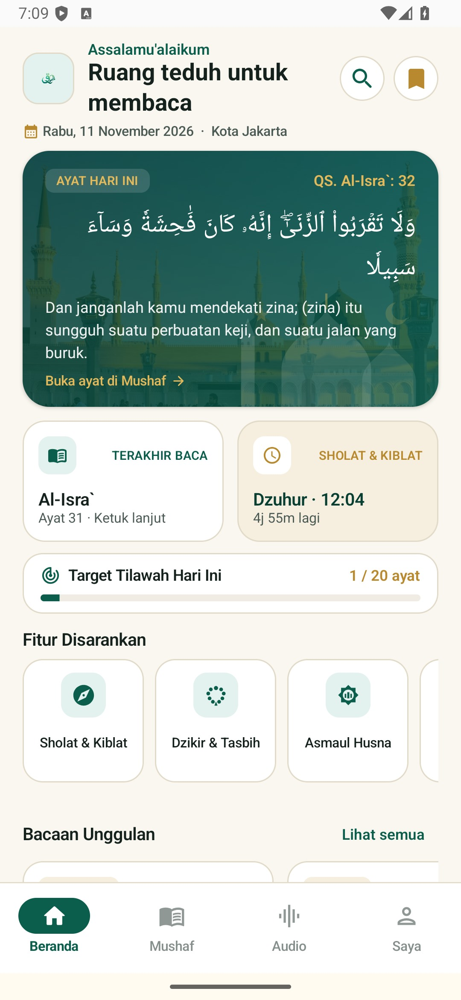
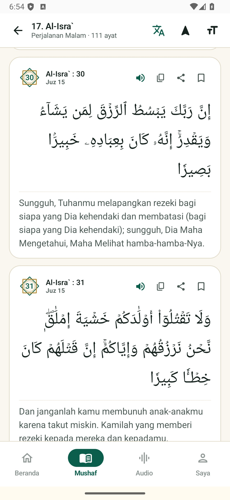
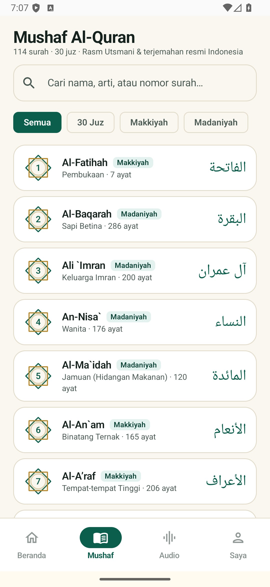
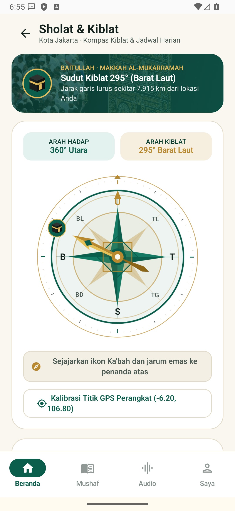
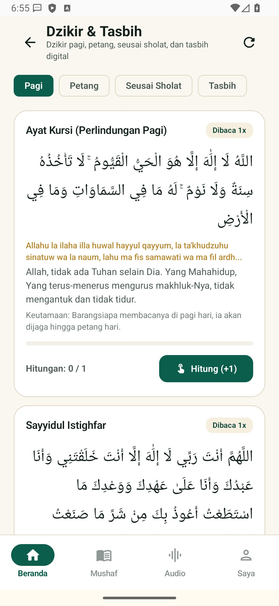
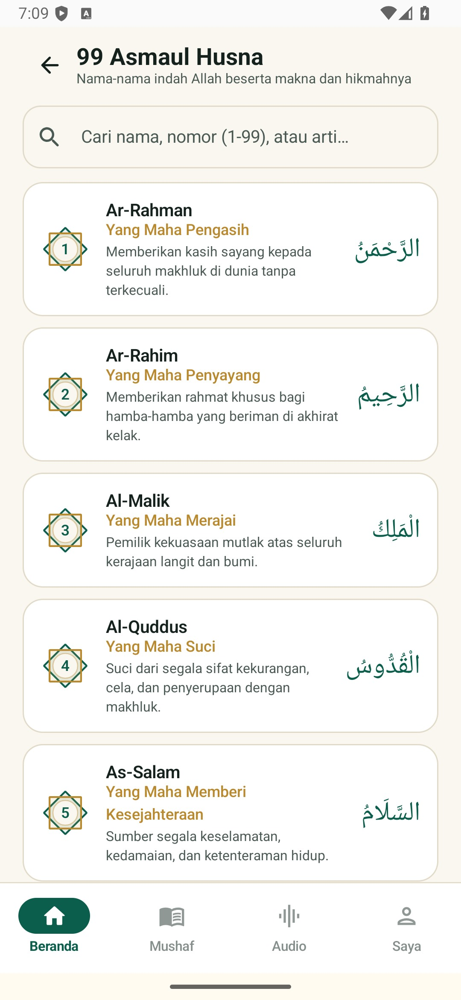
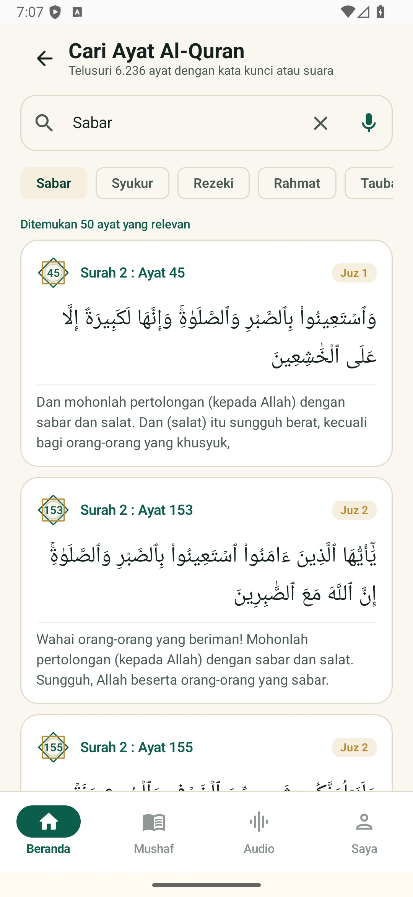
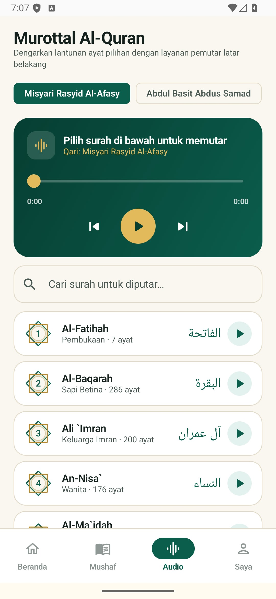
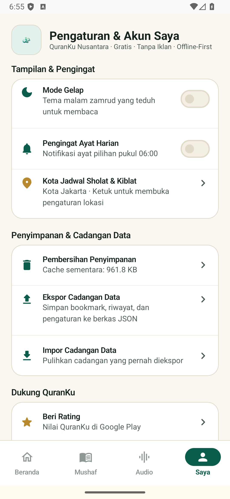

# QuranKu

<p align="center">
  
</p>

Versi aplikasi: **1.3.0** - kode versi **4**

Aplikasi Al-Qur'an luring (*offline-first*) untuk pengguna Indonesia, dirancang dengan sistem desain **Mushaf Nusantara** menggunakan Kotlin, Jetpack Compose, MVVM, dan Clean Architecture.

## Gambaran Umum

QuranKu menyediakan akses membaca Al-Qur'an 114 surah (6.236 ayat) secara luring penuh lengkap dengan terjemahan Bahasa Indonesia, catatan kaki terjemahan Kementerian Agama RI, pemutar audio murottal per surah maupun per ayat, kompas kiblat dengan piringan arah mata angin Nusantara, jadwal waktu sholat dan imsakiyah per kota, 99 Asmaul Husna, serta Dzikir Pagi, Petang, dan Tasbih Digital.

## Fitur Utama

- **Beranda Mushaf Nusantara**:
  - Kartu **Ayat Hari Ini** berlatar ilustrasi dan fotografi masjid luring yang berganti otomatis setiap hari dan dapat dibuka langsung ke ayatnya di Mushaf.
  - Kartu status berukuran seragam untuk **Terakhir Baca** dan **Sholat & Kiblat** (menampilkan waktu sholat berikutnya beserta hitung mundur).
  - **Target Tilawah Harian** dengan bilah progres dan pilihan target harian (5, 10, 20, 30, atau 50 ayat per hari).
  - Pintasan **Fitur Disarankan** dan **Bacaan Unggulan** dengan ukuran kartu yang konsisten dan proporsional.
- **Mushaf Al-Qur'an & Direktori 30 Juz**:
  - Daftar 114 surah dengan penyaring cepat (**Semua**, **30 Juz**, **Makkiyah**, dan **Madaniyah**) serta pencarian nama, arti, atau nomor surah.
  - Mode baca per ayat dan mode mushaf 15 baris dengan dukungan *pinch-to-zoom* dan pengaturan ukuran huruf Arab (22 sp hingga 42 sp).
  - **Mode Fokus Arab / Terjemahan** untuk menyembunyikan atau menampilkan terjemahan secara instan.
  - **Putar Audio per Ayat**, **Catatan Kaki Terjemahan**, **Salin Ayat**, **Bagikan Ayat**, **Simpan Bookmark**, serta navigasi **Surah Sebelumnya / Berikutnya**.
- **Kompas Kiblat & Jadwal Sholat 7 Waktu**:
  - Piringan kompas 8 arah mata angin Nusantara (`U`, `TL`, `T`, `TG`, `S`, `BD`, `B`, `BL`) dengan skala derajat per 5 derajat, jarum kiblat emas beranimasi halus, penanda Ka'bah pada sudut kiblat kota, serta perhitungan jarak garis lurus (kilometer) ke Baitullah di Makkah.
  - Jadwal harian 7 waktu (**Imsak**, **Subuh**, **Terbit**, **Dzuhur**, **Ashar**, **Maghrib**, dan **Isya**) untuk ratusan kota di Indonesia dengan pengingat notifikasi azan via `AlarmManager`.
- **Dzikir Pagi, Petang, Setelah Sholat & Tasbih Digital**:
  - Kumpulan bacaan dzikir autentik lengkap dengan teks Arab, transliterasi Latin, terjemahan Indonesia, dalil keutamaan, dan penghitung ketukan per bacaan.
  - **Tasbih Digital** mandiri dengan umpan balik getar (*haptic feedback*), pilihan target hitungan (33, 99, 100, 1000), dan pencatat putaran.
- **99 Asmaul Husna**:
  - Katalog lengkap 99 nama indah Allah beserta kaligrafi Arab, transliterasi, arti, pencarian cepat, dialog tadabbur makna, dan fitur salin.
- **Murottal Audio Latar Belakang**:
  - Pemutar audio berbasis Media3 `MediaSessionService` dengan pilihan 4 qari internasional (Misyari Rasyid Al-Afasy, Abdul Basit Abdus Samad, Abdurrahman As-Sudais, dan Mahmud Khalil Al-Hussary) serta pencarian surah.
- **Pencarian Ayat & Eksplorasi Keislaman**:
  - Pencarian teks Arab atau terjemahan Indonesia secara instan, dilengkapi **Pencarian Suara** (*SpeechRecognizer* Bahasa Indonesia) dan chip kata kunci populer.
  - **Quran & Sains** (18 fenomena ilmiah beserta rujukan ayat), **Penjelajah Topik** (berdasarkan kategori dan suasana hati), serta **Kajian Tematik**.
- **Manajemen Data & Pengaturan**:
  - Dukungan **Mode Gelap** dan **Mode Terang** berpalet zamrud dan kertas krem hangat yang nyaman di mata.
  - Pengingat ayat harian terjadwal (`WorkManager`), **Ekspor & Impor** cadangan data JSON (*Storage Access Framework*), dan pembersihan cache penyimpanan.

## Tampilan Aplikasi

Lihat [dokumentasi foto aplikasi](docs/FOTO-APLIKASI.md) untuk rincian visual setiap layar.

| Beranda | Mushaf Ayat | Daftar Surah & 30 Juz |
|---|---|---|
|  |  |  |

| Kompas Kiblat & Sholat | Dzikir & Tasbih Digital | 99 Asmaul Husna |
|---|---|---|
|  |  |  |

| Pencarian Ayat | Murottal Audio | Pengaturan & Saya |
|---|---|---|
|  |  |  |

## Struktur Proyek

- `app`: modul utama aplikasi Android berbasis Kotlin dan Jetpack Compose (`id.nusantara.quran`).
- `assets/logo`: aset identitas visual resmi aplikasi QuranKu.
- `docs`: dokumentasi teknis, status fitur, matriks paritas, lisensi sumber data, dan tangkapan layar aplikasi.
- `fastlane`: metadata distribusi berbahasa Indonesia.
- `inventory`: catatan inventaris data dan sumber legal.
- `peacedesign`: dokumentasi sistem desain yang diimplementasikan pada paket `inti/ui/tema`.
- `tools`: skrip utilitas Python untuk penyiapan data Al-Qur'an lokal.

## Menjalankan dan Memasang

Pastikan Android SDK Platform 34 dan JDK 17 tersedia, lalu jalankan perintah berikut dari direktori root proyek:

```text
gradlew.bat assembleDebug
gradlew.bat assembleRelease
```

Berkas APK siap pasang tersedia pada:
- `app/build/outputs/apk/release/QuranKu-v1.3.0.apk` (atau `app-release.apk`)
- `app/build/outputs/apk/debug/app-debug.apk`

Untuk memasang langsung ke perangkat atau emulator Android melalui ADB:

```text
adb install -r app/build/outputs/apk/release/QuranKu-v1.3.0.apk
```

## Sumber Data dan Atribusi

Teks Al-Qur'an, terjemahan, audio murottal, dan jadwal waktu sholat mengacu pada sumber terbuka Tanzil, QuranEnc, Kementerian Agama RI, EveryAyah, dan API MyQuran sebagaimana dijelaskan pada [dokumen sumber data dan lisensi](docs/SUMBER-DATA-DAN-LISENSI.md).
