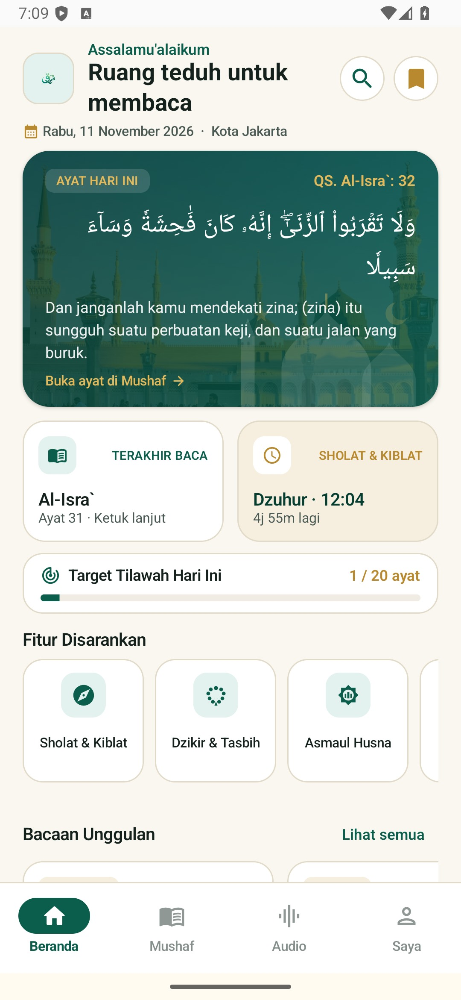
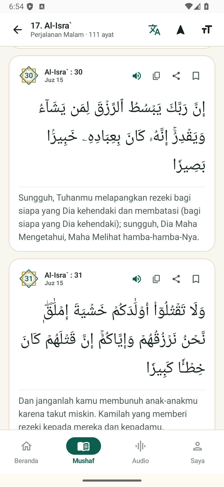
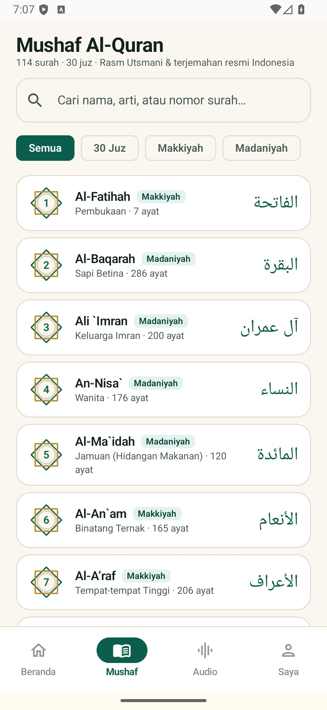
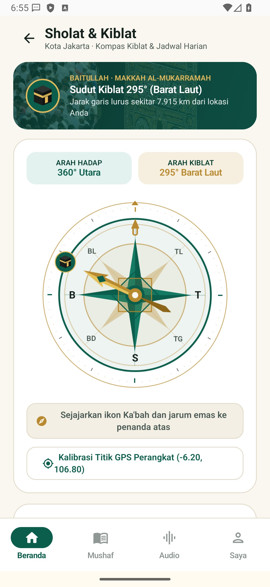
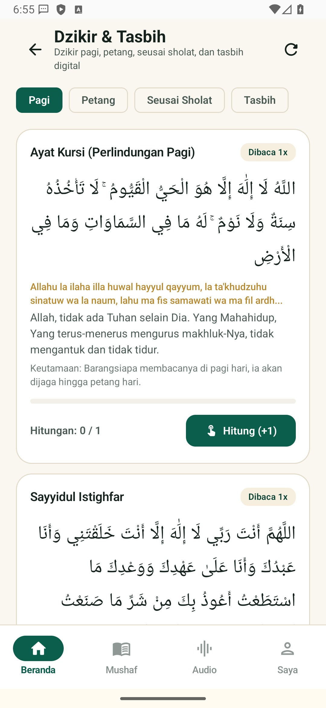
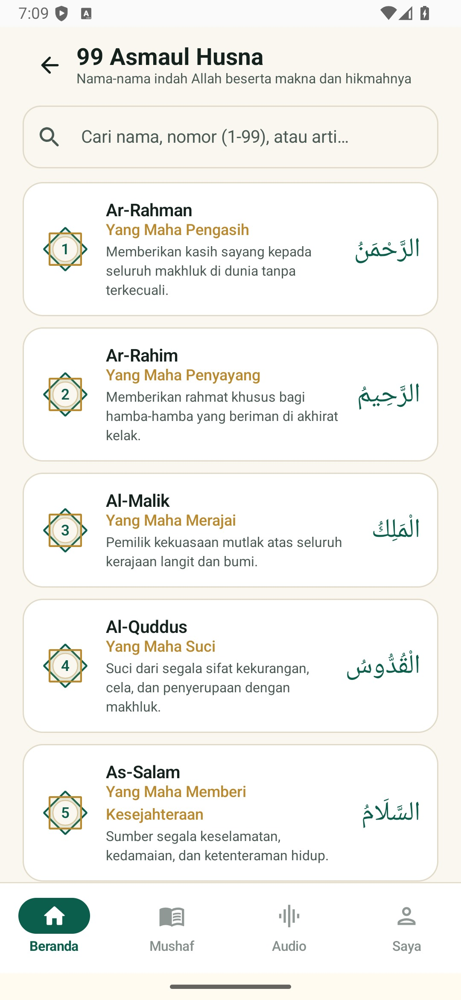
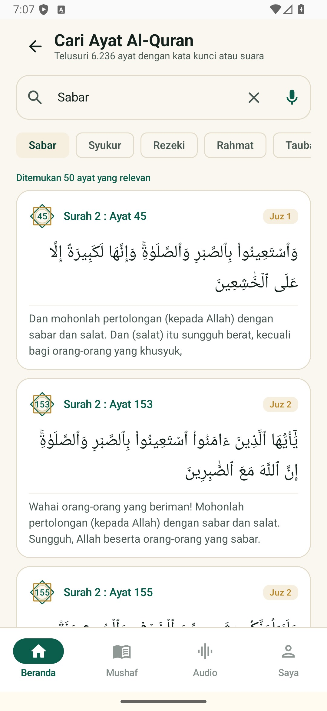
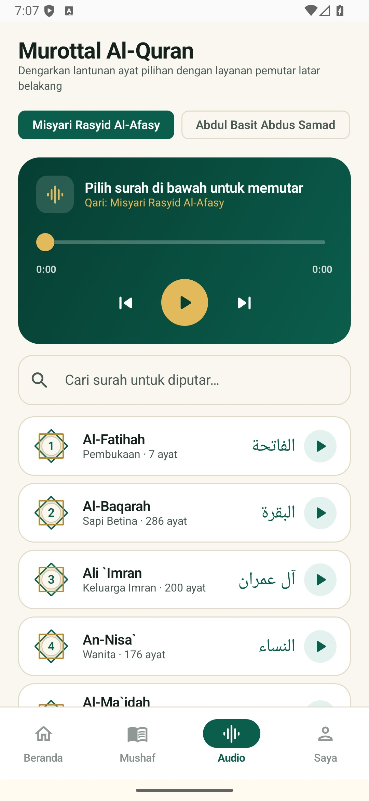
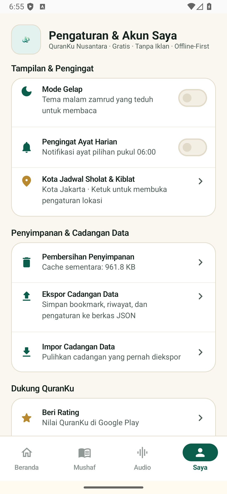

# Dokumentasi Foto Aplikasi

Berikut dokumentasi visual aplikasi **QuranKu v1.3.0** dari hasil kompilasi terbaru. Seluruh gambar disimpan di dalam direktori `docs/foto/` agar dapat ditinjau langsung dari repositori.

## 1. Beranda Mushaf Nusantara

Menampilkan salam pembuka, penanggalan dan kota aktif, kartu Ayat Hari Ini berlatar masjid luring, kartu Terakhir Baca dan Sholat & Kiblat berukuran seragam, bilah progres Target Tilawah Harian, serta baris Fitur Disarankan dan navigasi bawah kontras tinggi.

## 2. Pembaca Mushaf Al-Qur'an

Menampilkan pembaca ayat-per-ayat dengan lencana nomor ayat berbentuk bintang delapan sudut (*Rub el Hizb*), teks Arab Rasm Utsmani, terjemahan Bahasa Indonesia, serta tombol putar audio per ayat, salin, bagikan, dan simpan bookmark.

## 3. Daftar Surah & Indeks 30 Juz

Menampilkan direktori 114 surah dengan pencarian cepat serta penyaring Semua, 30 Juz, Makkiyah, dan Madaniyah.

## 4. Kompas Kiblat Mata Angin Nusantara & Jadwal Sholat

Menampilkan kartu informasi arah Baitullah beserta jarak garis lurus ke Makkah, piringan kompas 8 mata angin Nusantara (`U`, `TL`, `T`, `TG`, `S`, `BD`, `B`, `BL`) dengan jarum kiblat emas dan lencana Ka'bah, serta jadwal sholat 7 waktu harian.

## 5. Dzikir Pagi, Petang, Seusai Sholat & Tasbih Digital

Menampilkan bacaan dzikir harian dilengkapi teks Arab, transliterasi Latin, terjemahan, keutamaan, penghitung ketukan per bacaan, serta mode Tasbih Digital mandiri.

## 6. 99 Asmaul Husna

Menampilkan katalog 99 nama indah Allah secara luring beserta kaligrafi Arab, arti Bahasa Indonesia, dan penjelasan makna.

## 7. Pencarian Ayat Al-Qur'an & Pencarian Suara

Menampilkan pencarian instan pada 6.236 ayat Al-Qur'an dengan kata kunci teks, mikrofon pencarian suara berbahasa Indonesia, dan chip topik populer.

## 8. Murottal Audio Latar Belakang

Menampilkan kartu kendali pemutar audio murottal dengan pilihan qari internasional dan daftar putar surah.

## 9. Pengaturan & Akun Saya

Menampilkan pengaturan Mode Gelap, Pengingat Ayat Harian, Kota Jadwal Sholat & Kiblat, Pembersihan Penyimpanan, Ekspor/Impor Cadangan JSON, dan informasi aplikasi.

